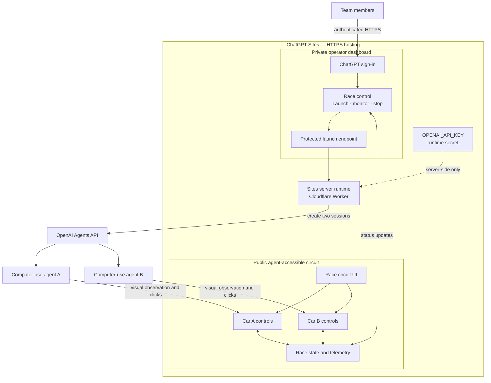

# Team and Prototype — 2026-10-18

## Team

- Taketo — concept design, product direction, and pitch
- Takao Ken ([@takaoken](https://x.com/takaoken)) — data/AI engineering and initial prototype
- akari ([@Rijikai_](https://x.com/Rijikai_)) — AR, engineering, and HCI interests

The team coordinated through an X group chat created by Takao Ken after meeting at the DevDay hackathon eve party.

## Current Prototype

Takao Ken created the initial working prototype using the OpenAI Agents API with computer use.

The prototype is a two-car circuit race:

- Two agents compete in the same racing environment.
- Each agent independently drives one car.
- Each agent uses computer-use controls to perceive the environment and operate its car.

## Demo Story

Two AI agents perceive, decide, act, and compete in a shared visual environment in real time.

## Concept Background — Tesla Roadster Event

The team's visual and presentation concept was inspired by [Tesla's October 2026 Roadster event post](https://x.com/Tesla/status/2110976226084970849). The shared reference showed a theatrical night demonstration built around an illuminated curved ramp, airborne vehicle motion, vapor, and high-contrast red-and-white lighting.

The team carried forward the event's underlying presentation ideas:

- Make vehicle behavior immediately legible through movement rather than explanation.
- Turn a technical capability into a short, memorable live spectacle.
- Use a shared arena to create tension, comparison, and a clear payoff.
- Present autonomy as visible action: perception, decision, control, and recovery.

Agent Circuit applies those ideas to two AI-controlled cars competing on one circuit. The reference influenced the atmosphere and demo storytelling, not the implementation or branding. The project is independent of Tesla, and the motion concept uses original assets without Tesla imagery, logos, or vehicle designs.

## Proposed Sharing and Hosting Architecture

Use ChatGPT Sites as the durable team-demo host, with a security boundary between the operator controls and the page driven by the computer-use agents.

### Security boundary

- Team members authenticate to the private operator dashboard.
- Only the private dashboard can launch or stop billable agent sessions.
- The race circuit is publicly reachable so OpenAI-hosted computer-use browsers can operate it.
- `OPENAI_API_KEY` is stored as a Sites runtime secret and is never included in browser code.
- Public write endpoints require their own authorization.

### Deployment direction

- Preferred durable deployment: ChatGPT Sites.
- Immediate fallback during migration: Cloudflare Quick Tunnel from the local prototype.
- The existing Node server must be adapted to the Sites/Vinext Cloudflare Worker runtime.
- Private-site authentication may not be available inside a hosted computer-use browser; this is why the circuit and operator dashboard are separated.
- Optional WebMCP tools can expose the circuit's existing actions to compatible browser agents, while preserving ordinary visual controls.

## Immediate Questions

1. What decisions can each driving agent make?
2. What differs between the agents—the prompt, strategy, model, memory, or tools?
3. How is performance measured beyond simply winning the race?
4. What is the clearest visible moment that proves computer use is controlling both cars?
5. What failure or recovery behavior makes the demo more than a scripted race?
6. Should the public circuit use short-lived race IDs or signed session tokens to prevent unauthorized control?
7. What telemetry transport should connect the public circuit and private dashboard within the Sites runtime?

## References

- [Agents API computer use documentation](https://developers.openai.com/api/docs/guides/agents-api/tools/computer-use)
- [Tesla Roadster event reference on X](https://x.com/Tesla/status/2110976226084970849)
- [Takao Ken on X](https://x.com/takaoken)
- [akari on X](https://x.com/Rijikai_)
